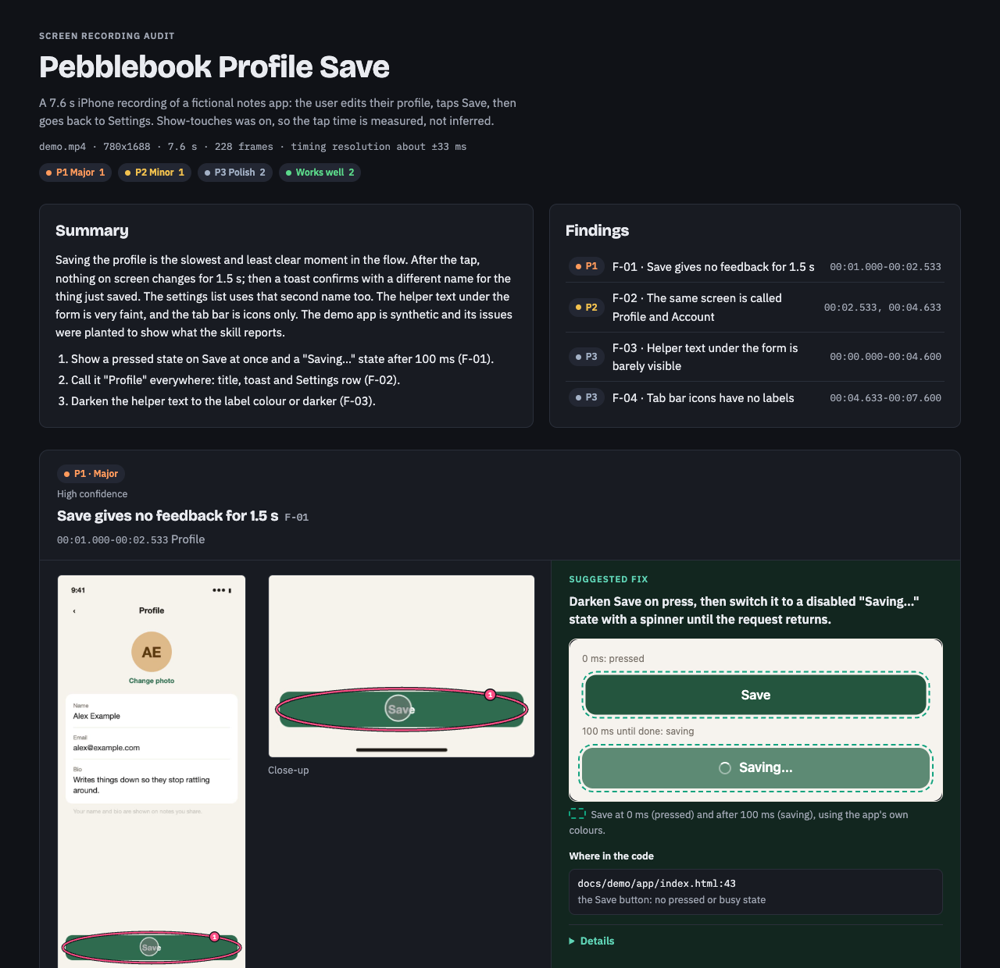

# Demo: Pebblebook profile save

A worked example of the skill's output on a short recording of **Pebblebook**, a notes app that doesn't
exist. Its screens are a single HTML file ([`app/index.html`](app/index.html)) with four problems planted on
purpose. Everything else in this folder is real output from the skill's scripts.

| File | What it is |
|---|---|
| [`recording.mp4`](recording.mp4) | The 7.6 s "iPhone" recording, with show-touches on. Rebuild it with [`make_recording.sh`](make_recording.sh). |
| [`analysis.md`](analysis.md) | `rec_audit.py analyze` output: timing, change timeline, input candidates |
| [`measurements.md`](measurements.md) | `rec_audit.py measure --input 1.0`: the Save tap, 1,533 ms to the first change |
| [`findings.json`](findings.json) | What Claude wrote after looking at the frames and reading `app/index.html` |
| [`report/index.html`](report/index.html) | The rendered page (download the `report/` folder and open it) |
| [`report/report.md`](report/report.md) | The same report as Markdown |



## What it found

| ID | Severity | Finding | Evidence |
|---|---|---|---|
| F-01 | P1 | Save gives no feedback for 1.5 s | measured: first change +1533 ms after the tap, ±33 ms |
| F-02 | P2 | The same screen is called Profile and Account | title vs toast vs Settings row |
| F-03 | P3 | Helper text is barely visible | ~1.5:1 by eye; the code confirms #cfcac3 on #f6f3ee, 1.47:1 |
| F-04 | P3 | Tab bar icons have no labels | icon-only tabs, inactive grey 2.96:1 |

Every fix comes with an HTML/CSS mock-up built from the app's own colours, and a file-and-line reference
into `app/index.html`.

## Reproduce

```bash
S=skills/audit-recording/scripts
python3 $S/rec_audit.py analyze docs/demo/recording.mp4 --out /tmp/demo-audit --platform ios
python3 $S/rec_audit.py measure /tmp/demo-audit --input 1.0 --until 4.5 --label "Tap Save" \
  --method "show-touches dot" --ignore 320,1480,110,110
cp docs/demo/findings.json /tmp/demo-audit/
python3 $S/render_report.py /tmp/demo-audit
```
